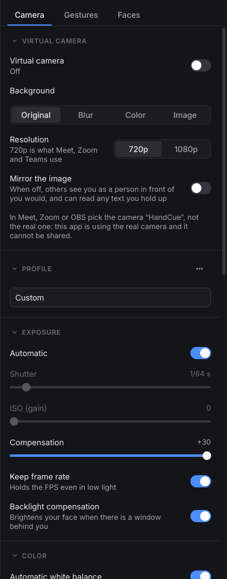
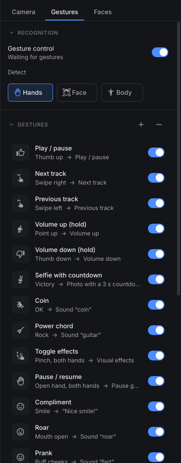
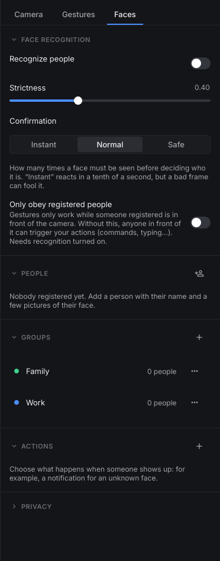

# HandCue

[](https://github.com/Ignacio-Aranda/handcue/actions/workflows/ci.yml)
[](LICENSE)

HandCue is a Linux desktop app that watches your webcam and turns hand, face and body
gestures into actions: pause the music with a thumbs up, skip a track with a swipe, lock the
screen when you walk away, type a message, move the mouse with your hand. It also gives you
proper controls for the webcam itself and a virtual camera with background blur for video
calls.

Everything runs on your computer. Images never leave it.

| | | |
|---|---|---|
|  |  |  |

## What it does

- **Gestures**: 16 hand gestures (fist, thumbs up, pinch, swipes...), 12 facial expressions
  (smile, wink, raised eyebrows, head turns...) and 8 body poses or presence events.
- **Actions**: media keys and volume, open an app or a website, keyboard shortcuts, type text,
  run a command, notifications, sound effects, photos with countdown, screenshots, lock the
  screen and a virtual mouse.
- **Face recognition**: register people and groups, run actions when someone known or unknown
  shows up, and optionally make the app obey registered people only.
- **Webcam settings**: exposure, white balance, focus, zoom and framing with face tracking,
  anti-flicker and saved profiles. Settings are written to the camera, so they also apply in
  OBS, Meet or Zoom, and the app restores them after a reboot or suspend.
- **Virtual camera**: blur or replace your background and use it as a webcam in any app.
- **Tray app**: starts on login, pauses when the privacy shutter is closed.

The full list, with what is still missing, is in [docs/features.md](docs/features.md).

## Requirements

- Linux with KDE Plasma or GNOME (Wayland or X11). Developed and tested on Debian 13 with
  KDE Plasma 6.
- A UVC webcam.
- Python 3.11 or newer if you install it with pip.
- Typing, shortcuts and the virtual mouse use the XDG desktop portal (RemoteDesktop). The
  desktop asks for permission the first time.

## Install

### Debian 13 / Ubuntu 24.04 (.deb)

Download the `.deb` for your system and `SHA256SUMS` from the
[latest release](https://github.com/Ignacio-Aranda/handcue/releases/latest), then:

```bash
sha256sum --check --ignore-missing SHA256SUMS
sudo apt install ./handcue_0.1.0_debian13_amd64.deb      # Debian 13
sudo apt install ./handcue_0.1.0_ubuntu24.04_amd64.deb   # Ubuntu 24.04
```

### Any distribution (pipx)

```bash
pipx install https://github.com/Ignacio-Aranda/handcue/releases/download/v0.1.0/handcue-0.1.0-py3-none-any.whl
handcue
```

### From source

```bash
git clone https://github.com/Ignacio-Aranda/handcue.git
cd handcue
make venv
make run
```

On first use the app downloads its ML models (about 40 MB) from Google's MediaPipe storage
and the OpenCV model zoo. Each file is checked against a SHA-256 hash before it is used.

### Virtual camera (optional)

The virtual camera needs the `v4l2loopback` kernel module. The app shows the exact command
in *Camera > Virtual camera*; see [docs/virtual-camera.md](docs/virtual-camera.md).

## Using it

1. Open *HandCue* from the app menu. From then on it also starts with your session
   (you can turn that off in Preferences).
2. In the *Gestures* tab, turn on the gestures you want or add your own with **+**. Each
   gesture has a detection time, so it has to be held for a moment before it fires.
3. Use **Try it** in the editor to test an action without making the gesture.
4. Closing the window keeps the app running in the system tray.

## Privacy and security

- No network access except downloading the models on first use.
- Settings live in `~/.config/handcue` and face data in `~/.local/share/handcue`,
  both readable only by you. Faces are encrypted with AES-256-GCM using a key kept in the
  desktop keyring.
- Anyone in front of the camera can make your gestures. If you bind something sensitive
  (commands, typing), turn on *Faces > Only obey registered people*. Face recognition can be
  fooled with a photo, so treat it as a convenience, not as a lock.
- The *Run command* action runs whatever you type with your permissions. Do not import
  someone else's configuration without reading its commands.

Details in [docs/security.md](docs/security.md). To report a vulnerability, see
[SECURITY.md](SECURITY.md).

## Documentation

- [Features and status](docs/features.md)
- [Architecture](docs/architecture.md)
- [Configuration file](docs/configuration.md)
- [Face recognition](docs/face-recognition.md)
- [Virtual camera](docs/virtual-camera.md)
- [Security and privacy](docs/security.md)
- [Packaging and releases](docs/packaging.md)
- [Roadmap](ROADMAP.md) and [changelog](CHANGELOG.md)

## Contributing

Bug reports, translations and pull requests are welcome. Start with
[CONTRIBUTING.md](CONTRIBUTING.md).

## License

HandCue is free software under the [GNU General Public License v3.0 or later](LICENSE).

It bundles the [Inter](https://rsms.me/inter/) typeface (SIL Open Font License 1.1) and uses
icons from [Material Design Icons](https://pictogrammers.com/library/mdi/) through QtAwesome.
The ML models are published by Google ([MediaPipe](https://ai.google.dev/edge/mediapipe))
and the OpenCV project ([YuNet and SFace](https://github.com/opencv/opencv_zoo)) under their
own licenses.
